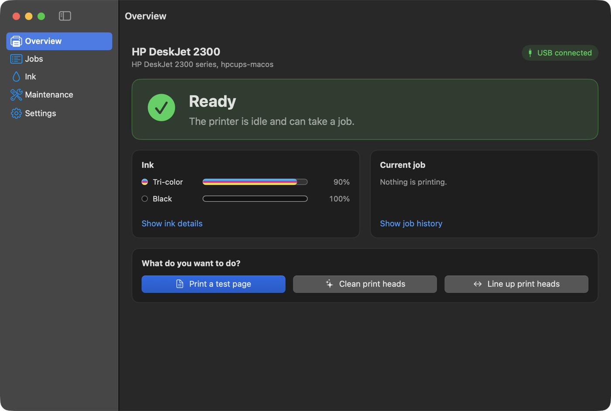
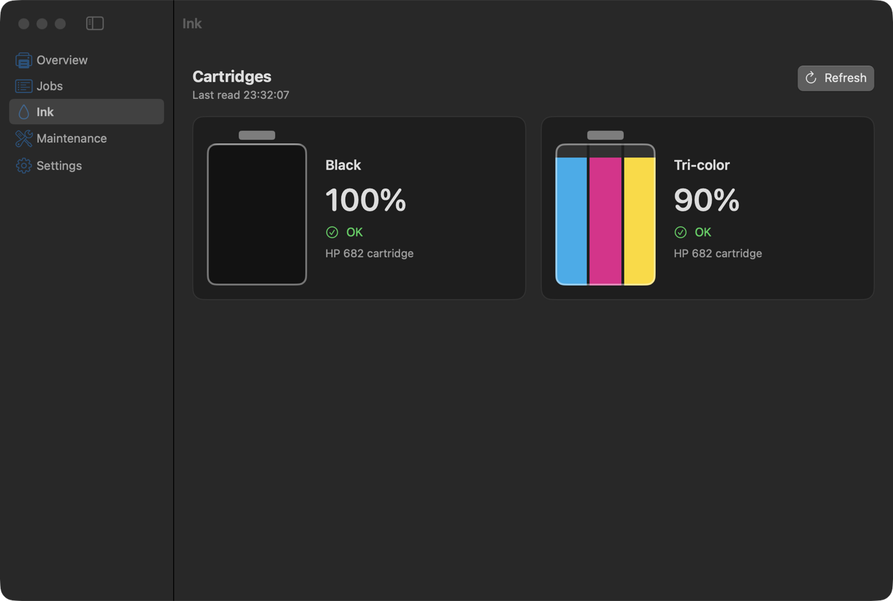
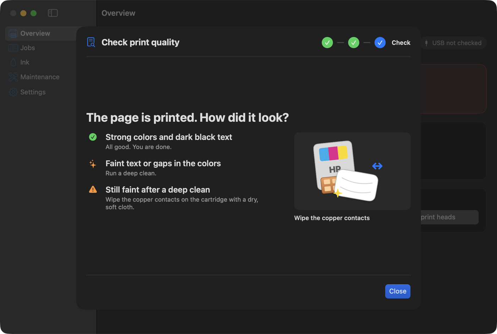
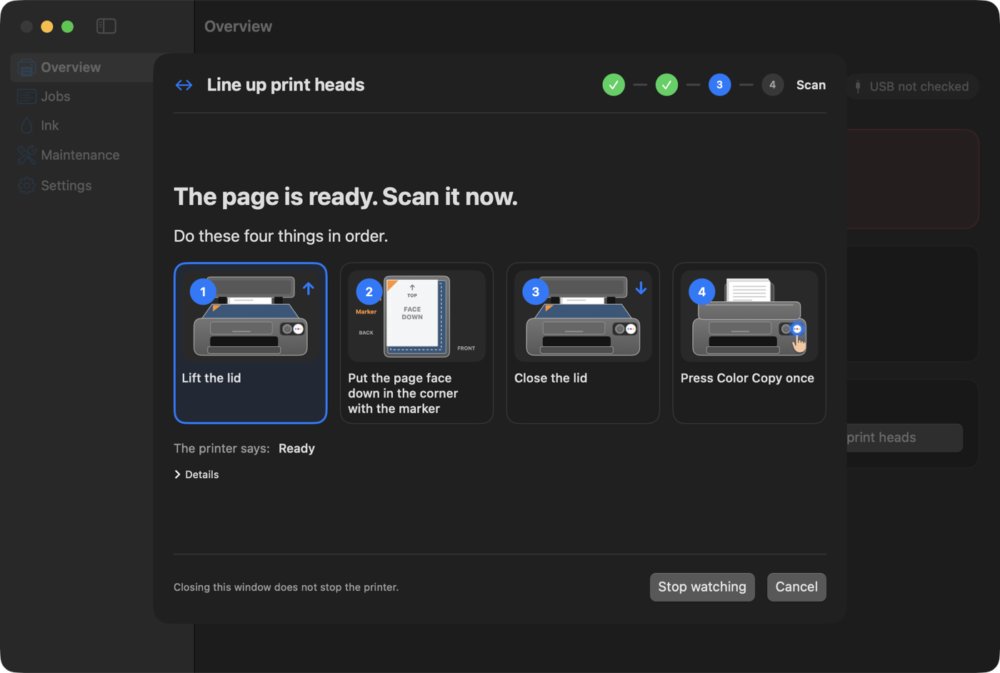

  

<h1 align="center">hpcups-macos</h1>

  A working Mac driver and a friendly status app for the HP DeskJet 2300 over USB. 
  Built from HP's own open-source code, because HP would not ship one.

  
  
  
  
  

  

## Why this exists

I plugged a DeskJet 2300 into a Mac with a USB cable. The Mac saw it straight away. It just would not print.

macOS has no driver for this model. The printer has no AirPrint over USB, so the driverless path is closed too. The generic drivers macOS offers send garbage, or nothing.

HP's answer was its app. The app only looks for printers on Wi-Fi or Ethernet. This printer has neither. HP Easy Start searched and said it could not find any software for the product.

Apple's HP driver package is from 2020. It does not include this model, and its installer refuses to run on anything newer than macOS 12.

HP does publish a driver that supports this printer. It is called HPLIP, it is open source, and it only builds for Linux. So this project builds it for the Mac.

## A note to HP

You sold this printer with a USB port and a scanner on top. Then you made sure a Mac owner could use neither.

- No macOS driver. Not an old one, not a broken one. None.
- An app that cannot see a USB printer at all.
- An "Easy Start" that searches, finds nothing, and links to a support page.
- Head cleaning, alignment and ink levels locked behind software that does not exist for this printer on this platform.
- A working driver you wrote yourselves, sitting in HPLIP under an open license, that you never built for the Mac.

Every one of those features was already in the printer. It answers ink and maintenance requests over its own USB cable. You just never wrote the Mac side.

Getting one page out of it cost me an evening. This repository is the Mac side you skipped.

Fuck you, HP.

## What you get

**A real print driver.** The `hpcups` filter from HPLIP 3.25.2, built natively for Apple Silicon. It links only against macOS system libraries and installs where the Mac print system expects it.

**A status app** with a Dock icon, a main window and a menu bar item.

- Printer state in plain words: ready, printing, needs paper, door open, unplugged.
- Ink levels for the black and tri-color cartridges, read from the printer itself.
- Your print jobs, with cancel and pause.
- Guided cleaning, deep cleaning, a diagnostics page and head alignment, with pictures for every step.

  

## Install

1. Download `hpcups-macos-<version>.pkg` from the [latest release](https://github.com/gamunu/hpcups-macos/releases/latest).
2. The package is not signed with an Apple Developer ID. Right click it in Finder, choose **Open**, then **Open** again.
3. Plug in the printer.
4. Open **System Settings > Printers & Scanners**, click **Add Printer**, pick **DeskJet 2300 series**, and set **Use** to "HP DeskJet 2300 series, hpcups-macos".

If macOS still refuses the package, **System Settings > Privacy & Security** shows an **Open Anyway** button for it.

The package installs the filter, a PPD for each supported printer, and `/Applications/hpcups Status.app`. It does not add the printer for you.

From a shell, the same steps are:

    sudo installer -pkg hpcups-macos-<version>.pkg -target /
    lpinfo -v | grep -i usb
    sudo lpadmin -p HP_DeskJet_2300 -E -v "<usb uri from lpinfo>" \
        -P "/Library/Printers/PPDs/Contents/Resources/HP DeskJet 2300 series (hpcups-macos).ppd.gz"

## Using the app

Open **hpcups Status** from Applications. The Overview tells you whether the printer is ready and what to do if it is not.

### Faint or streaky prints

1. Go to **Maintenance** and run **Clean print heads**. Load blank paper first.
2. Run **Print diagnostics page** and look at it. The app tells you what to do next.
3. Still faint after a deep clean? Take the cartridge out and wipe its copper contacts with a dry, soft cloth.

That last step is what brought a "dead" black cartridge back during testing. It was full of ink. Dried ink on the contacts stopped the nozzles from firing.

  

### Lining up the print heads

**Line up print heads** prints a page, then walks you through scanning it. Lift the lid, put the page face down in the marker corner, close the lid, press **Color Copy**. The app follows the printer and highlights the step it is waiting for.

  

Every running task has a **Cancel** button. If the printer gets stuck waiting for a scan, the Overview and the menu bar offer **Cancel alignment**.

## Supported printers

778 HPLIP PPD files, covering over 2,000 HP model names: DeskJet, Envy, Smart Tank, OfficeJet, PSC, Photosmart, Business Inkjet, Neverstop and a set of LaserJet and Color LaserJet models. They speak eight print languages: PCL3GUI2 (359 files), LaserJet PCL (121), PCL3GUI (82), PCL3 (64), LaserJet color PCL (59), LIDIL (51), HBPL1 (40, PCLm output) and PCLXL fast raster (2). The full list, one row per model with its language, is in [docs/supported-printers.md](docs/supported-printers.md). It is generated by `scripts/gen-ppds.py`.

Only the DeskJet 2300 series has been tested on real hardware. The rest are checked offline: every PPD passes `cupstestppd`, and `make test` runs the filter once per language and checks the bytes it writes. A model in the list can still print wrong, and the status app only knows the 2300.

Models that need HP's closed binary plugin are left out, 46 PPD files in all. So are 33 JBIG-compressed LaserJet files (ZJS and ZX stream) that need the plugin's JBIG code even though HP's data does not say so, and 3 JetReady and QuickConnect files whose JPEG color table is not ported. `ppd/hplip/excluded.tsv` has every excluded file with its reason.

Printers are added in **System Settings > Printers & Scanners** as before. The PPDs are in `/Library/Printers/PPDs/Contents/Resources/hpcups-macos/`.

## How it works

**Printing.** CUPS turns your document into raster pages and hands them to `hpcups`, which encodes them as PCL3GUI for the printer. The filter is HPLIP's code with HP's prebuilt image library and dbus left out. `src/hpcups/UPSTREAM` lists the changes.

**Ink and maintenance.** The printer has a second USB interface (class 255, subclass 4, protocol 1) with a small web server on it. HP calls it LEDM. HPLIP uses it on Linux. The app claims that interface through IOUSBHost and sends HTTP requests to it.

CUPS keeps the printing interface, so the two never fight over the cable.

This printer answers slowly, and a reply can arrive after the next request has gone out. The client sends one request at a time, drains leftover bytes, reads the full reply and checks the XML root matches what it asked for.

Alignment on this model goes Printing, ScanRequested, Scanning, then back to ready. It never reports "CalibrationValid", even after a good alignment, so the app treats a pass through Scanning as done.

## Build from source

You need Xcode and `brew install jpeg-turbo pkgconf`.

    make                   # the hpcups filter in build/hpcups
    make test              # renders pages offline and checks the PCL output
    cd app && swift test   # unit tests for the app's printer logic
    scripts/build-app.sh   # build/hpcups Status.app
    make pkg               # build/hpcups-macos-<version>.pkg

`"build/hpcups Status.app/Contents/MacOS/hpcups Status" --dump` prints the printer state, ink and job list as text. `--ledm-get <path>` prints one raw printer document. `--preview-step <name>` opens a maintenance step with fake data, so you can look at the screens without printing.

## Releases and updates

The app checks for updates with Sparkle once a day, and **Check for Updates...** is in the app menu. An update is the same `.pkg` as a fresh install, so the driver and the app move together.

Releases come from [release-please](https://github.com/googleapis/release-please). Nobody tags by hand.

1. Merge pull requests into `main` with Conventional Commit messages. `fix:` bumps the patch version, `feat:` the minor version, and a `!` or `BREAKING CHANGE:` the major version.
2. release-please keeps a "chore(main): release x.y.z" pull request open with the next version and the `CHANGELOG.md` entry.
3. Merging that pull request tags `vX.Y.Z` and creates the GitHub Release. The release workflow then builds the package, signs it for Sparkle, writes `appcast.xml` and attaches both.

### One-time setup for maintainers

Do this before the first release. A build without the public key can never verify an update, so its users would have to reinstall by hand.

    scripts/build-app.sh
    BIN="$PWD/app/.build/artifacts/sparkle/Sparkle/bin"
    "$BIN/generate_keys"
    "$BIN/generate_keys" -x /tmp/sparkle_private_key
    gh secret set SPARKLE_PRIVATE_KEY --repo gamunu/hpcups-macos < /tmp/sparkle_private_key
    rm /tmp/sparkle_private_key
    gh variable set SPARKLE_PUBLIC_KEY --repo gamunu/hpcups-macos --body "$("$BIN/generate_keys" -p)"

Back the private key up in a password manager. Lose it and every installed copy needs a manual reinstall.

## Uninstall

    sudo lpadmin -x HP_DeskJet_2300
    sudo scripts/uninstall.sh

This removes the app, the filter, the PPDs and the installer receipt.

## License

hpcups-macos is AGPL-3.0-or-later. See [LICENSE](LICENSE).

HP's files in `src/hpcups/` and `src/common/` keep their own headers: BSD-style, MIT, or GPL-2.0-or-later. All three can be combined into an AGPL-3.0-or-later work. [LICENSING.md](LICENSING.md) lists which file carries which license. HPLIP's license text is in [COPYING](COPYING).

## Thanks

To the HPLIP developers, for writing and publishing the driver HP itself would not ship for the Mac. Every page this printer prints on a Mac goes through their code.
